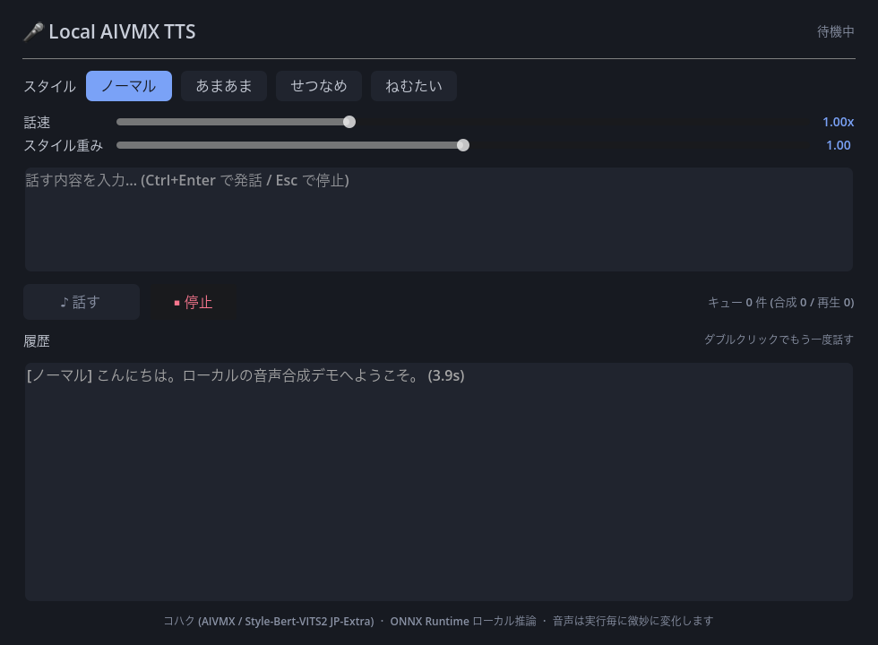

# LocalAivmxTts

[](LICENSE)


**Run [AivisSpeech](https://github.com/Aivis-Project/AivisSpeech)-compatible AIVMX voice models entirely locally from Godot 4 (C#/.NET) —
no Python, no HTTP server, no external TTS engine.**

```text
Japanese text ──▶ normalization ──▶ G2P (phonemes + accent) ──▶ BERT features ──▶ AIVMX (ONNX) ──▶ 44.1 kHz PCM
                (NAIST dict)        (DotNetG2P + MeCab)         (DeBERTa v2)        (ONNX Runtime)
```

`LocalAivmxTts` is a Godot-free C# core library plus a Godot 4.7 demo app. Everything runs in-process on
[ONNX Runtime](https://github.com/microsoft/onnxruntime); your game just calls `SynthesizeAsync(text)` and plays the returned PCM.

<p align="center">
  
</p>

## Table of Contents

- [Features](#features)
- [Models you need](#models-you-need)
- [Quick Start (demo app)](#quick-start-demo-app)
- [Use it in your own Godot project](#use-it-in-your-own-godot-project)
- [Synthesis options](#synthesis-options)
- [CLI (verification tools)](#cli-verification-tools)
- [Architecture and compatibility notes](#architecture-and-compatibility-notes)
- [Development](#development)
- [Project layout](#project-layout)
- [License](#license)

## Features

- **Fully local inference** — text-to-speech inside your game process; works offline after models are placed
- **pyopenjtalk-compatible G2P** — phoneme/accent labels verified against 16 reference dumps (`compare`: 16/16 slugs PASS)
- **Styles and prosody controls** — 4 styles (ノーマル / あまあま / せつなめ / ねむたい), style weight, speaking speed, plus SDP / noise scalars
- **Game-oriented facade** — async initialization+synthesis, one-at-a-time execution, in-memory cache for repeated lines, cancellation
- **Godot demo app** — dark-themed UI, hotkeys (Ctrl+Enter to speak, Esc to stop), history replay from cache, headless smoke test mode
- **Verification CLI** — `compare` (label-level diff vs pyopenjtalk dumps), `synth` (WAV output), `g2p`, `meta`, `onnx`

## Models you need

This repository **does not include any model or dictionary** (see [THIRD-PARTY-LICENSES.md](THIRD-PARTY-LICENSES.md)). Place them as follows — the demo and CLI look them up automatically by walking up from the project directory to `LocalAivmxTts.sln`, then using `research/`. (Override the root with the `LOCALAIVMX_ROOT` environment variable.)

| Path | What | Source |
|------|------|--------|
| `research/kohaku.aivmx` | コハク voice model (Style-Bert-VITS2 JP-Extra, 44.1 kHz) | `コハク.aivmx` shipped with [AivisSpeech](https://aivis-project.com/speech/) (official release) — license: ACML 1.0 |
| `research/bert/model_fp16.onnx` | DeBERTa v2 JP char (large) BERT, FP16 ONNX | [tsukumijima/deberta-v2-large-japanese-char-wwm-onnx](https://huggingface.co/tsukumijima/deberta-v2-large-japanese-char-wwm-onnx) — CC-BY-SA-4.0 |
| `research/bert/tokenizer.json` | matching char tokenizer | same Hugging Face repo |
| `research/naist-jdic/` | NAIST Japanese dictionary (`sys.dic`, `unk.dic`, …) | [naist-jdic](https://sourceforge.net/projects/naist-jdic/) — BSD |

```text
research/
├── kohaku.aivmx
├── bert/
│   ├── model_fp16.onnx
│   └── tokenizer.json
└── naist-jdic/
    ├── sys.dic
    ├── unk.dic
    ├── char.bin
    └── ...
```

Other AIVMX models (AivisSpeech official / [AivisHub](https://hub.aivis-project.com/)) drop in the same way — pass the path to `InitializeAsync`.

## Quick Start (demo app)

Requirements: **.NET SDK 8.0+** and **Godot 4.7 (.NET/mono edition)** — the standard (non-.NET) Godot build cannot load C# scripts.

```bash
# clone, place models as above, then:
dotnet build godot/Demo.csproj

# macOS: launch the .NET Godot binary directly
~/Applications/Godot_mono.app/Contents/MacOS/Godot --path godot
# …or open godot/project.godot in the Godot (.NET) editor and press Play
```

The demo opens with the engine initializing (a few seconds), then:

| Action | Effect |
|--------|--------|
| Ctrl+Enter | Synthesize + play the input text with the selected style/sliders |
| Esc | Stop synthesis and playback, clear queues |
| History double-click | Replay the entry — served instantly from the cache |
| Style buttons / sliders | Style id, style weight (0–2), speed (0.5–2.0) |

A headless smoke test (init → synthesize one line → exit) is built in:

```bash
TTS_DEMO_SMOKE=1 <Godot .NET binary> --headless --path godot
# [TtsSpeaker] Ready: ... (44100Hz / 4 styles)
# [Smoke] exit, state=Idle
```

## Use it in your own Godot project

Reference `src/LocalAivmxTts/LocalAivmxTts.csproj` from your Godot .NET project (it has no Godot dependency):

```csharp
using System;
using Godot;
using LocalAivmxTts.Engine;
using LocalAivmxTts.Inference;

public partial class MySpeaker : Node
{
    private LocalTtsEngine engine = null!;

    public override void _Ready()
    {
        _ = StartAsync();
    }

    private async System.Threading.Tasks.Task StartAsync()
    {
        // once at startup (AIVMX + BERT + dictionary load takes a few seconds)
        engine = await LocalTtsEngine.InitializeAsync(
            aivmxPath: "voice/kohaku.aivmx",
            bertModelPath: "models/model_fp16.onnx",
            tokenizerJsonPath: "models/tokenizer.json",
            naistJdicPath: "models/naist-jdic");

        await Speak("こんにちは。ローカルの音声合成です。", "あまあま");
    }

    private async System.Threading.Tasks.Task Speak(string text, string style)
    {
        var options = new SynthesisOptions(StyleId: engine.Styles[style], StyleWeight: 1.0f, SpeedScale: 1.1f);
        var wave = await engine.SynthesizeAsync(text, options);   // cached for identical (text, options)

        // convert float32 mono PCM to 16-bit little-endian bytes
        var bytes = new byte[wave.Audio.Length * 2];
        for (var i = 0; i < wave.Audio.Length; i++)
        {
            var v = (short)Math.Round(Math.Clamp(wave.Audio[i], -1f, 1f) * 32768f);
            bytes[2 * i] = (byte)v;
            bytes[2 * i + 1] = (byte)((uint)v >> 8);
        }

        var stream = new AudioStreamWav
        {
            Format = AudioStreamWav.FormatEnum.Format16Bits,
            MixRate = wave.SampleRate,   // 44100
            Stereo = false,
            Data = bytes,
        };
        var player = new AudioStreamPlayer { Stream = stream };
        AddChild(player);
        player.Play();
    }
}
```

> Synthesis is serialized inside the engine (one ONNX call at a time) and identical requests are answered from an in-memory cache,
> so queueing many lines is safe. `ClearCache()` frees memory; the engine is `IDisposable`.

## Synthesis options

`SynthesisOptions` (all parameters optional, defaults follow AivisSpeech):

| Parameter | Default | Meaning |
|-----------|---------|---------|
| `StyleId` | `0` | Style vector row (see `engine.Styles`: ノーマル=0 / あまあま=1 / せつなめ=2 / ねむたい=3) |
| `StyleWeight` | `1.0` | Blend weight toward the style vector from the model average (0–2 supported) |
| `SpeedScale` | `1.0` | Speaking speed; `length_scale = 1 / max(0.1, SpeedScale)` |
| `SdpRatio` | `0.2` | Stochastic duration predictor share |
| `NoiseScale` | `0.6` | Decoder/flow noise |
| `NoiseScaleW` | `0.8` | SDP noise |

Notes: outputs are **non-deterministic** — the AIVMX decoder samples from a random normal distribution, so the same request
produces a slightly different waveform every run (same as AivisSpeech Engine). Text containing no pronounceable characters
returns 0.25 s of silence instead of failing (matches the reference pipeline's guard).

## CLI (verification tools)

`tools/Sbv2Cli` ships with path resolution built in — it finds the repo root and `research/` automatically:

```bash
cd tools/Sbv2Cli
dotnet run -- compare   # G2P → compare with pyopenjtalk 0.4.1 dumps: all 16 slugs PASS
dotnet run -- synth "今日もいい天気ですね" --style あまあま --weight 0.6 --speed 1.2 --out out.wav
dotnet run -- g2p "ディスプレイ"                   # print normalized text / tones / phones / word2ph
dotnet run -- meta ../../research/kohaku.aivmx     # model metadata (styles, sampling rate…)
dotnet run -- onnx path/to/model.onnx             # ONNX input/output signatures
```

## Architecture and compatibility notes

```
src/LocalAivmxTts                    (Godot-free, POCO + System.* only)
├── Nlp/                 JapaneseTextNormalizer (numbers→kanji, punctuation cleanup), G2P, MoraTable
├── Model/               AivmxPackage (protobuf/npy parsing), HyperParameters, ONNX graph info
├── Inference/           BertFeatureExtractor, Sbv2Synthesizer (rank-1 inputs, style vec), WaveWriter
└── Engine/              LocalTtsEngine facade (async init, serialize, cache)

godot/                               Godot 4.7 .NET demo (thin adapter only)
├── scripts/TtsSpeaker.cs            queue/playback/cancel on the main thread
├── scripts/TtsPaths.cs              model path resolution
└── scripts/Demo.cs                  code-built UI
```

- The G2P output is **label-identical to pyopenjtalk 0.4.1** for the reference corpus (word boundaries, tones, phones),
  including half↔full-width handling, the ヲ→オ particle, accent-phrase-leading long-vowel stripping, and ディ/ティ repairs.
  See [`docs/02_g2p_compat.md`](docs/02_g2p_compat.md) (Japanese) for every verified rule and known delta.
- ONNX (`x_tst`, `tones`, `language`, …) input shapes and the BERT feature path follow the reference ONNX inference
  implementation; details in [`docs/01_architecture.md`](docs/01_architecture.md) (Japanese).

## Development

```bash
dotnet build LocalAivmxTts.sln          # src + CLI
dotnet build godot/Demo.csproj          # demo (Godot.NET.Sdk 4.7.0 via NuGet; no editor needed to build)
cd tools/Sbv2Cli && dotnet run -- compare   # needs research/naist-jdic + tools/pythonref/dump/*.json
```

CI builds the solution and the demo across Linux/macOS/Windows (`.github/workflows/ci.yml`).

## Project layout

| Path | Contents |
|------|----------|
| `src/LocalAivmxTts` | Core library (see above) |
| `tools/Sbv2Cli` | Verification CLI and reference dumps (`tools/pythonref/dump`) |
| `godot/` | Godot 4.7 (.NET) demo application |
| `docs/` | Design + compatibility research notes (Japanese) |
| `research/` | Third-party models/dictionaries — **git-ignored, must be prepared separately** |

## License

Code: [MIT](LICENSE) © i-icc.
Models and dictionaries are **not part of this distribution** and carry their own licenses — see
[THIRD-PARTY-LICENSES.md](THIRD-PARTY-LICENSES.md) for the full inventory (コハク: ACML 1.0 — credit request: “AivisSpeech: コハク”,
BERT: CC-BY-SA-4.0, naist-jdic: BSD, Style-Bert-VITS2/AivisSpeech: reference-only reimplementations).
The Japanese research notes under `docs/` are likewise part of this repository (MIT).
